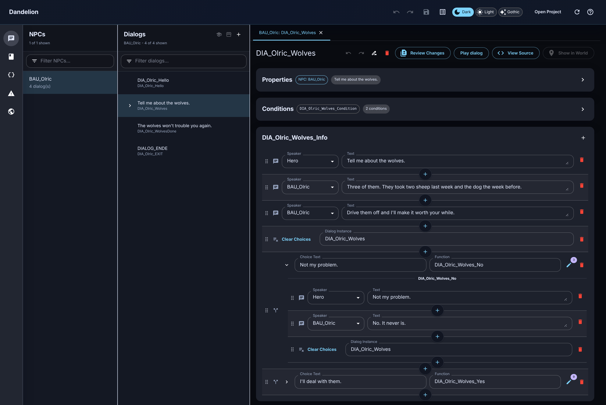

# Dandelion — Daedalus Dialog Suite

**Dandelion** is a desktop editor for Gothic 2 mods. It opens a mod's Daedalus
scripts and ZenGin worlds and lets you edit dialogs, quests, NPCs, routines and
worlds visually — and it writes every change back into your original files
without reformatting them.

**[Download the latest Windows build](https://daniel-daga.github.io/daedalus-dialog-suite/)** ·
[User guide](docs/user-guide.md) · [Changelog](CHANGELOG.md) ·
[Report a problem](https://github.com/daniel-daga/daedalus-dialog-suite/issues/new/choose)

## What it edits

- **Dialogs** — `C_INFO` instances and their functions: `AI_Output` lines,
  `Info_AddChoice` branches, conditions and actions. A simulator steps through
  them as the player would.
- **Quests** — `MIS_` state variables and `Log_CreateTopic` / `B_LogEntry`
  diary entries, cross-referenced to the dialogs that set them.
- **NPCs and routines** — `C_NPC` instance bodies (attributes, talents,
  equipment, visuals) with a bind-pose preview, and `Rtn_` daily routines
  edited against the waynet.
- **Worlds** — `.zen` files in a 3D viewport: move, place, duplicate and delete
  VOBs, edit their properties and the waynet, and start a GMBT test run.
- **Problems** — syntax errors plus project-wide checks, such as a dangling
  `Npc_KnowsInfo`, overlapping routines or a waypoint missing from the world.

**Your source stays yours.** Edits are patched into the original text: comments,
blank lines and expressions stay as written, in the file's original encoding.

## Install

Download the installer from the
[download page](https://daniel-daga.github.io/daedalus-dialog-suite/) and run
it. Windows only for now. The installer is **not code-signed yet**, so Windows
SmartScreen warns on first run ("More info" → "Run anyway"). The app checks for
updates itself and verifies each download's SHA-256 before installing it.

Then follow the [user guide](docs/user-guide.md): open your mod's scripts
folder with **Open Project**, and press **F1** in the app for every shortcut.

## Contributing

Bug reports, ideas and pull requests are welcome — see
[CONTRIBUTING.md](CONTRIBUTING.md) for setting up a checkout, running the tests
and how work is tracked. Security issues go through
[SECURITY.md](SECURITY.md), not public issues. Everyone taking part follows the
[code of conduct](CODE_OF_CONDUCT.md).

The repository is a monorepo:

| Package | What it is |
|---|---|
| [`daedalus-dialog-editor/`](daedalus-dialog-editor/) | The Electron + React editor (Dandelion) |
| [`daedalus-parser/`](daedalus-parser/README.md) | Tree-sitter grammar for Daedalus, semantic model and code generator — usable on its own |
| [`zenkit-node/`](zenkit-node/README.md) | Node binding around [ZenKit](https://github.com/GothicKit/ZenKit) for ZenGin worlds |
| [`zen-world/`](zen-world/README.md) | Pure TypeScript world-editing domain |
| [`blender-addon/`](blender-addon/) | Blender add-on for `.zen` worlds (experimental) |

Design and architecture docs live in [`docs/`](docs/README.md).

## License

MIT — see [LICENSE](LICENSE). The `zenkit-node/vendor/ZenKit` submodule is
[ZenKit](https://github.com/GothicKit/ZenKit), under its own MIT license.

## Disclaimer

This is an unofficial fan project. It is not affiliated with or endorsed by
THQ Nordic or Piranha Bytes. Gothic is a trademark of its respective owners.
The repository ships no game assets or original game scripts; all test
fixtures are synthetic.
